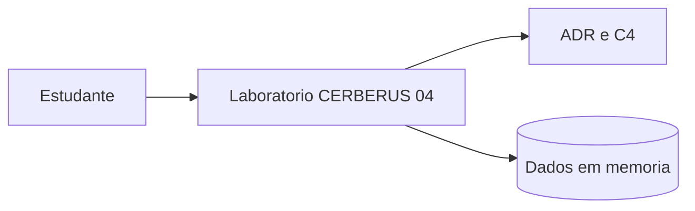
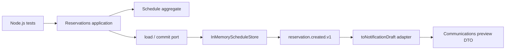

# CERBERUS 04 | C4 simplificado

Os diagramas abaixo representam o exemplo local em Node.js, não a infraestrutura de produção.

## Nível 1: Contexto

O estudante executa os testes e consulta a documentação. Os dados são demonstrativos e armazenados somente em memória.

## Nível 2: Containers lógicos

Os elementos acima são **containers lógicos de um único processo**, sem deploy independente. Não existem microsserviços, rede, SQLite, gateway, broker ou banco externo neste Lab 04.

## Mapa de componentes

- **Bounded context Reservas:** Schedule, regras de capacidade, ReserveSeats e a store de memória.
- **Evento público:** reservation.created.v1 (eventCode, bookingId, seats).
- **Bounded context Comunicações:** adaptador toNotificationDraft, que converte o evento em DTO local e não importa a aggregate.
- **Segurança e limites:** sem autenticação, concorrência multi-instância, persistência, filas reais, envio de notificações ou dados pessoais.
