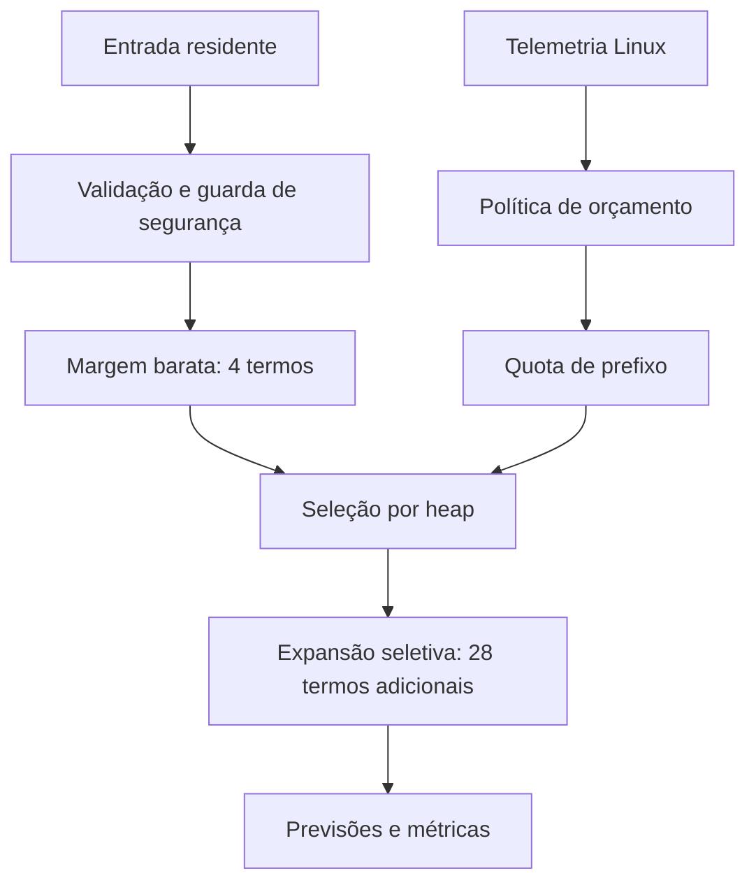

# ICARUS: computação adaptativa nativa sob restrições de recursos

**Projeto Limiar | The Workshop Research | LIM-I001**  
**Autor:** Gabriel Oliveira Pereira (Kingmaker), The Workshop  
**Versão:** 1.0.0 — manuscrito de encerramento experimental, 25 de novembro de 2026  
**Estado:** research only; ciclo experimental encerrado (PARTIAL ASCENSION); confirmação sintética GAUSS concluída, OMEGA terminal concluído; sem revisão por pares ou replicação independente.  
**Revisão do Ciclo I:** `37e848d2886c6cd9937951139cec6d1e991008f5`.  
**Revisão terminal OMEGA:** `11fe6a3286f35749caf37d5fe6664d2f5bf6e1ca`.

## Resumo

Este trabalho investiga a viabilidade de distribuir computação de forma seletiva em hardware de recursos limitados, combinando classificação por estágios, restrições de orçamento lógico, execução nativa e observação de recursos Linux. O protocolo ICARUS evoluiu por seis experimentos (WAX, FEATHER, DAEDALUS, ASCENSION, HELIOS e SOLARIS) e uma validação final, EXP-00X ÍCARO. O domínio inicial é um classificador linear sintético de 32 atributos, com expansão opcional de quatro para 32 termos. A variante final utiliza uma fila de prioridade para selecionar exemplos de menor margem absoluta sob quotas de prefixo. Em 30 sementes, 46.080 exemplos e 720 lotes, a variante obteve 93,5308% de acurácia contra 94,8199% do FULL nativo, redução de 53,1456% dos termos, de 92,4921% do custo de CPU do observador frente a HELIOS e de 85,5273% do custo amortizado total frente a PROMETHEUS. Não houve violação registrada do orçamento lógico. Entretanto, a perda de 1,2891 ponto percentual excedeu o limite pré-declarado de 1 p.p.; o custo total também foi aproximadamente 9,88% superior ao FULL nativo. Quatro dos cinco critérios finais foram satisfeitos. O resultado caracteriza um compromisso entre qualidade, custo de observação e seleção. ATHENA amplia a investigação com quatro pilotos de seleção (680.960 exemplos sintéticos), 66.218 verificações matemáticas limitadas e dois pilotos nativos de custo. LEVER observou, em configuração IID específica, redução mediana de CPU de 69,05% com perda de 0,781 p.p. usando seleção causal; em distribuição adversa, as metas conjuntas não foram atingidas. GAUSS confirmou condicionalmente, em 120 sementes inéditas e cinco blocos, redução geométrica de CPU de 61,1415% e perda de 0,8236 p.p., com limites superiores unilaterais aproximados de 95% de 0,4078 para a razão CPU e 0,9446 p.p. para a perda. ATLAS investigou sinais reais de smartphone. No estudo terminal OMEGA, com MotionSense, oito participantes reservados e 3.640 janelas, a redução de CPU do kernel foi 55,7689% (limite inferior 55,6570%), com perda macro de 2,9293 p.p. (limite superior 4,6775 p.p.) e redução de RSS de 0,6924%. A execução nativa independente de Python e a integridade lógica foram verificadas nos relatórios, mas a hipótese conjunta não foi satisfeita. O fluxo nativo completo foi 2,66% mais lento descritivamente. O veredito terminal é PARTIAL ASCENSION. Não se demonstra aceleração universal, economia de energia ou redução significativa de memória.

**Palavras-chave:** computação condicional, orçamento de recursos, seleção por margem, Linux, código nativo, restrições de prefixo, benchmarking.

## 1. Introdução

A escassez de recursos não implica que toda tarefa deva ser executada uniformemente em sua configuração mais cara. A computação condicional explora diferenças de dificuldade entre entradas, mas decidir quando executar trabalho adicional tem custo próprio. Uma política adaptativa só é vantajosa se a economia de trabalho superar esse custo e se a qualidade permanecer aceitável.

O objetivo de ICARUS é testar esse compromisso empiricamente, e não contornar limites físicos do hardware. As perguntas centrais são: (i) é possível reduzir avaliações de termos preservando qualidade? (ii) é possível limitar rigorosamente o custo lógico de cada prefixo? (iii) qual parcela do custo é atribuível à implementação, ao observador e à política? (iv) quando o sistema adaptativo supera uma alternativa nativa igualmente otimizada?

As três primeiras perguntas motivam o Ciclo I. A quarta motivou os pilotos exploratórios do [Protocolo ATHENA](scientific/README.md), apresentados na seção 11.

## 2. Trabalhos relacionados

Classificação sequencial sob orçamento [1], cascatas de classificadores com custo de atributos [2] e classificação em lote com saídas antecipadas [3] fornecem precedentes diretos para a seleção de trabalho por entrada. Sistemas progressivos orientados a recursos, como SPINN [4], ilustram a relevância da integração com o ambiente de execução. As quotas aninhadas de ICARUS relacionam-se à teoria de matroides laminares [5]. A metodologia de benchmarking deve distinguir repetições internas, sessões e máquinas [6].

ICARUS não reivindica a invenção de early exit, filas de prioridade, controle por realimentação ou otimização gulosa. A contribuição em estudo é a caracterização conjunta de seleção por margem, prefixos lógicos, custo de observação e execução nativa em uma plataforma restrita. A revisão de literatura é exploratória; ver [ALEXANDRIA](scientific/ALEXANDRIA.md) para lacunas e plano de busca.

## 3. Modelo matemático

### 3.1 Classificação sintética

Para uma entrada com 32 atributos gaussianos, define-se a pontuação completa

$$
s(x)=\sum_{j=1}^{4}x_j+0.15\sum_{j=5}^{32}x_j.
$$

A pontuação barata é $s_4(x)=\sum_{j=1}^{4}x_j$. O rótulo sintético decorre do sinal da pontuação completa perturbada por ruído gaussiano. A previsão é binária. Não há treinamento do vetor de pesos: trata-se de uma família sintética deliberadamente favorável à concentração de informação nos primeiros quatro atributos. A confiança heurística é $w_i=|s_4(x_i)|$, não uma probabilidade calibrada de acerto.

FULL avalia 32 termos; LITE avalia quatro. Uma saída antecipada por limiar usa LITE quando a margem é suficientemente alta, expandindo nos demais casos. O limiar é escolhido exclusivamente na calibração. O holdout não deve influenciar a política.

### 3.2 Orçamento e garantia de prefixo

Seja $n$ o tamanho do lote, $b$ o orçamento médio anunciado em termos por entrada, $S$ o conjunto de entradas expandidas. O custo lógico de um prefixo de tamanho $i$ é

$$
C_i=4i+28|S\cap\{1,\ldots,i\}|.
$$

A exigência $C_i\le ib$ para todo $i$ equivale a

$$
|S\cap\{1,\ldots,i\}|\le q_i,\qquad q_i=\left\lfloor\frac{i(b-4)}{28}\right\rfloor.
$$

O modelo exige custo incremental uniforme de 28 termos, orçamento constante no lote e $b\in\{8,16,24,32\}$. No replay com teto exato de expansões $K$, substitui-se $q_i$ por $Q_i=\min(q_i,K)$; sem teto, $Q_i=q_i$.

Nos controladores causais anteriores, o crédito acumulado é $ib-C_i$. Uma expansão é permitida apenas se o custo após a decisão couber no prefixo corrente. A realimentação modifica a política, mas a garantia decorre da barreira de crédito, não da estabilidade do controlador.

### 3.3 Seleção ÍCARO: otimização discreta em lote

A política final maximiza lexicograficamente a cardinalidade de $S$ e, entre soluções de cardinalidade máxima, minimiza $\sum_{i\in S}w_i$; empates favorecem índices menores.

Pseudocódigo:

```text
H = max_heap()               # ordenação (margem absoluta, índice)
para i = 1 até n:
    inserir (abs(s4(x[i])), i) em H
    Q = floor(i * (b - 4) / 28)
    se houver teto K: Q = min(Q, K)
    se tamanho(H) > Q:
        remover maior elemento de H
S = índices restantes em H
avaliar pontuação completa somente para i em S
```

**Proposição 1 (viabilidade e cardinalidade).** Como $Q_i$ é não decrescente e aumenta no máximo uma unidade a cada passo, o heap termina cada passo com cardinalidade $Q_i$. Inserir o índice corrente não modifica prefixos anteriores; remover qualquer elemento não aumenta sua contagem. Por indução, todos os prefixos são viáveis, e a cardinalidade final atinge o limite superior $Q_n$.

**Proposição 2 (mínima soma de margens).** Por indução mais forte, para qualquer $k\le Q_i$, os $k$ menores elementos do heap constituem uma solução viável de peso mínimo com cardinalidade $k$ no prefixo $i$. Uma solução ótima ou exclui o elemento corrente (melhores $k$ anteriores) ou o inclui (melhores $k-1$ anteriores mais o atual). Selecionar os $k$ menores da união compara essas alternativas; remover o máximo acima de $Q_i$ não altera a solução para $k\le Q_i$. Para $k=Q_n$ segue a propriedade desejada. Ver [EUCLID](scientific/EUCLID.md), que contém a formalização e as verificações locais concluídas; revisão independente pendente.

Exemplo: para $n=64,b=16$, existem no máximo 27 expansões e 1.012 termos totais, abaixo dos 1.024 permitidos. A complexidade é $O(n\log(n+1))$ em tempo e $O(n)$ em memória auxiliar, com implementação limitada a $n\le256$.

A garantia é matemática para contabilidade lógica; não é garantia de deadline, tempo de CPU, energia, segurança térmica ou acurácia. A seleção exige acesso ao lote inteiro e não equivale a uma política online causal. Margem mínima é o objetivo matemático, não maximização demonstrada da qualidade.

### 3.4 Modelo de custo e ponto de equilíbrio

Se $H$ é o custo incremental da adaptação em relação a uma referência com a mesma base comum, $e$ é o custo marginal constante da etapa cara por exemplo e $k$ exemplos são expandidos:

$$
T_{adapt}-T_{full}=H-(n-k)e.
$$

Logo, para $k<n$, a adaptação vence em CPU se $e>H/(n-k)$. É uma hipótese de modelo simplificado: cache, vetorização, tamanho de lote, representação e contenção podem tornar $H$ e $e$ dependentes do contexto. A comparação final com FULL evidencia que economizar termos não é suficiente para economizar CPU quando o trabalho evitado é barato.

## 4. Arquitetura



A arquitetura separa observação, decisão do orçamento, seleção e execução. O observador utiliza sinais de CPU, memória disponível, PSI (pressure stall information), frequência e temperatura quando disponíveis. HELIOS iniciou o acoplamento; PROMETHEUS amortizou leituras e introduziu histerese; SOLARIS integrou a via binária e o observador nativo; ÍCARO substituiu a realimentação integral de limiar por seleção discreta.

As guardas preservam o limite de memória disponível de 512 MiB e a parada a 80 °C nas rotinas que as implementam. A amostragem de sensores não garante segurança física contínua. Não se requer root, desativação de proteções térmicas ou exaustão intencional de recursos.

## 5. Metodologia experimental

A máquina de referência observada em WAX foi Intel Celeron N4020, dois CPUs lógicos disponíveis, 3.834.768 KiB de RAM reportada pelo Linux (aproximadamente 3,66 GiB), arquitetura x86_64, kernel 6.12.117+deb13-amd64 e Python 3.13.5. O alvo de 8 GB descrito no charter não deve ser confundido com a memória efetivamente reportada. Nas fases nativas, o resultado final registrou GCC 14.2.0, otimização -O2 e -ffp-contract=off.

| Etapa | Delineamento | Comparação principal |
|---|---|---|
| WAX | 7 repetições por carga, aquecimento | linha de base do ambiente |
| FEATHER | 5 sementes, 3.000 exemplos por split | full, lite, dinâmico |
| DAEDALUS | 10 sementes, 1.000 por regime variável | fixo protegido versus adaptativo |
| ASCENSION | 20 novas sementes, 5 repetições cronometradas | Python A1, variantes Python/C e C nativo |
| HELIOS | smoke de 1 semente; desenho original de 20 | observador e orçamento por lote |
| PROMETHEUS | 20 sementes, 480 lotes | observador original versus rápido |
| SOLARIS | piloto de 1 semente, 24 lotes | via binária e controle persistente |
| ÍCARO | piloto independente; 30 sementes finais, 720 lotes | 7 estratégias ao vivo e replay pareado |

As entradas são pareadas dentro de cada comparação; os espaços de sementes e calibração/holdout são separados conforme cada protocolo. Não se deve combinar tempos históricos medidos com fronteiras diferentes como se fossem um único benchmark.

Métricas: acurácia (proporção correta), diferença de qualidade em pontos percentuais, termos por exemplo, erro relativo de orçamento por segmento, maior excesso positivo de prefixo, CPU de processo, tempo de parede, percentis de latência e RSS de pico do processo. Para custo $X$ e referência $R$, a redução é $100(1-X/R)$%. A métrica de termos não mede instruções, custo de extração, energia ou tempo real. Os percentis agrupados de lotes são descritivos; sementes e lotes não são réplicas independentes de hardware.

## 6. Resultados do Ciclo I

Os resultados abaixo consolidam os protocolos, registros locais fornecidos anteriormente e o [ledger de evidências](scientific/CYCLE-I.md). WAX e o ledger fornecem valores explícitos; os números agregados de FEATHER, DAEDALUS e ASCENSION são transcrições de resumos experimentais anteriores, ainda sujeitos a recomputação completa a partir dos JSON. Não se apresenta esta consolidação como uma auditoria integral dos dados brutos.

### 6.1 EXP-001 WAX — a linha de base

[Protocolo e código](experiments/exp001-wax/README.md). Fonte: wax-local.json, revisão a38c5af189042d7427dae150828608d225de3d4a.

| Carga | Parâmetro | Mediana wall (ms) | Mediana CPU (ms) |
|---|---:|---:|---:|
| Inteiros | 250.000 iterações | 53,542284 | 52,947728 |
| Buffer | 1.048.576 bytes | 8,868290 | 8,863059 |

Pico RSS do processo: 13.696 KiB. Checksums: 2277468673 e 94371840, respectivamente. O teste de inteiros inclui interpretação Python; o de buffer inclui alocação e soma. Não é um teste de throughput teórico do processador ou largura de banda de DRAM. Sessões independentes adicionais não estão demonstradas.

### 6.2 EXP-002 FEATHER — computação condicional

[Protocolo](experiments/exp002-feather/README.md). Fonte: feather-local.json. Objetivo: redução de pelo menos 30% dos termos com perda de até 1 p.p. frente ao full.

Resumo anterior: redução média de 53,97% dos termos, perda média de aproximadamente 0,81 p.p. Exemplo auditável no registro local, semente 11: full 94,6333%, lite 86,8%, dinâmico 93,8%, 14,4907 termos contra 32 (54,7167% de redução). O resultado apoia a hipótese de seleção no domínio sintético; a diferença frente ao LITE mostra o valor da expansão seletiva. Não demonstra que os mesmos ganhos persistam em atributos de aquisição cara ou distribuições reais.

### 6.3 EXP-003 DAEDALUS — realimentação e crédito

[Protocolo](experiments/exp003-daedalus/README.md). Fonte: daedalus-local.json, revisão 54fe67dd3e7640349de8b6644f496ec93f316847.

Regimes anunciados 24, 8, 32 e 16 termos, com reinicialização de estado nas transições. O resumo anterior destaca 93,56% de acurácia, erro de orçamento de 0,28% e zero violações no resultado adaptativo destacado. Esses números não devem ser atribuídos indistintamente a todos os regimes; a tabela completa por cenário permanece no JSON. O objetivo de erro médio de até 5% e a proteção de prefixo são distintos de superioridade sobre o limiar fixo igualmente protegido. A telemetria física ainda não integra este experimento.

### 6.4 EXP-004 ASCENSION — otimização do caminho de execução

[Protocolo](experiments/exp004-ascension/README.md). Fonte: ascension-local.json.

A1 é o avaliador original; A2 reduz a frequência de atualização; A3 representa realimentação em ticks inteiros; A4 combina atualização periódica e caminho rápido de orçamento completo. Implementações C permitem separar efeitos de linguagem e de algoritmo.

No cenário destacado de oito termos, o resumo anterior registra redução média pareada de CPU de 99,42% frente a Python A1 e perda adicional de apenas 0,0025 p.p. O grande ganho é relativo ao baseline Python e exclui geração, calibração, compilação e empacotamento de entrada. Não é comparável diretamente à diferença entre duas estratégias C nativas nem à latência fim a fim.

### 6.5 EXP-005 HELIOS e extensão PROMETHEUS — observação do sistema

[HELIOS](experiments/exp005-helios/README.md) | [PROMETHEUS](experiments/exp005-helios/PROMETHEUS.md).

No smoke HELIOS (semente 701, 1.536 linhas), todos os orçamentos adaptativos foram 16; redução de 51,38% dos termos, acurácia adaptativa de 94,3359% contra 95,1823% FULL, nenhum excesso de prefixo. CPU com política: 4,124 ms versus 1,116 ms fixo nativo. Não houve demonstração de vantagem de CPU ou validação plena sob pressão controlada.

PROMETHEUS, revisão cf771e0: 30.720 linhas sintéticas, 480 lotes e 2.880 avaliações de estratégia.

| Métrica | HELIOS | PROMETHEUS repack |
|---|---:|---:|
| CPU amortizada do observador (µs) | 2.774,729 | 609,139 |
| CPU inclusiva (ms) | 3,820 | 1,583 |
| P95 reportado (ms) | 8,916 | 4,149 |
| Acurácia (%) | 93,5677 | 93,1087 |

FULL: 94,9154% de acurácia; PROMETHEUS: 14,0078 termos médios, 412 lotes de orçamento 16 e 68 de orçamento 8; zero excesso registrado. Redução do observador de 78,0469%, abaixo da meta de 80%. Contenção natural e leituras não simultâneas impedem inferência causal sobre desempenho sob cargas idênticas.

### 6.6 EXP-006 SOLARIS — integração nativa

[Protocolo e piloto](experiments/exp006-solaris/README.md). Fonte: solaris-smoke.json, revisão fb58359702cdf16275461f0f9941c1242f23c17c. Uma semente, 24 lotes, 1.536 entradas sintéticas.

| Métrica | Resultado do piloto | Meta |
|---|---:|---:|
| Redução CPU observador vs HELIOS | 92,16% | ≥90% |
| Redução CPU integrada vs PROMETHEUS | 84,72% | ≥50% |
| Acurácia persistente vs FULL | 90,56% vs 94,53% | perda ≤1 p.p. |
| Excesso de prefixo registrado | 0 | 0 |

A perda de aproximadamente 3,97 p.p. falhou no critério de qualidade. O deslocamento de limiar foi observado; windup induzido pela quantização permanece uma hipótese explicativa, não uma causalidade isolada. O estudo SOLARIS completo de 30 sementes não foi executado. O piloto motivou uma mudança de algoritmo, avaliada em sementes novas no EXP-00X.

## 7. EXP-00X ÍCARO — validação final

[Protocolo bloqueado](experiments/exp00x-icaro/README.md) | [Ledger](scientific/CYCLE-I.md). Fonte: icaro-final.json; árvore rastreada limpa, revisão final indicada no cabeçalho. O piloto icaro-smoke.json (semente 1299, 1.536 linhas, pico RSS 21.772 KiB) é separado e não foi incorporado ao resultado final.

O conjunto final utiliza as 30 sementes ímpares 1301–1359, 24 lotes de 64 linhas por semente e calibração independente de 1.000 linhas por semente. Sete estratégias ao vivo com a mesma entrada binária residente e rotação da ordem: HELIOS, PROMETHEUS, SOLARIS full, fixed, reset, persistent e ÍCARO. São 5.040 avaliações ao vivo; o total relatado de 12.240 avaliações inclui também o replay, não exemplos independentes adicionais. Não foi gerada pressão artificial.

### 7.1 Comparação ao vivo

| Métrica | Referência | ÍCARO |
|---|---:|---:|
| CPU amortizada total vs HELIOS (ms/lote) | 3,991156 | 0,248724 |
| CPU amortizada total vs PROMETHEUS (ms/lote) | 1,718572 | 0,248724 |
| CPU amortizada total vs FULL (ms/lote) | 0,226356 | 0,248724 |
| CPU amortizada do observador vs HELIOS (ms/lote) | 2,725433 | 0,204624 |
| Acurácia vs FULL (%) | 94,819878 | 93,530816 |
| Termos médios vs FULL | 32 | 14,993403 |
| Maior excesso lógico registrado | — | 0 |

A fronteira de tempo é a entrada serializada residente até a resposta: inclui validação, observação, seleção, avaliação e conversão do resultado, além da amortização do setup. Exclui geração/serialização da origem, espera por lote, disco, rede e sleeps do harness. Não é latência fim a fim de aplicação.

### 7.2 Critérios congelados

| Critério | Observado | Resultado |
|---|---:|---|
| Reduzir CPU do observador ≥90% frente a HELIOS | 92,4921% | Atendido |
| Reduzir CPU total ≥50% frente a PROMETHEUS | 85,5273% | Atendido |
| Perder no máximo 1 p.p. de acurácia frente a FULL | 1,2890625 p.p. | **Não atendido** |
| Zero excesso lógico de prefixo registrado | 0 | Atendido |
| Executar todas as 30 sementes finais | 30 | Atendido |

**Resultado: 4/5.** A diferença de CPU frente ao FULL nativo é aproximadamente +9,88%, desfavorável a ÍCARO. A economia de termos, aproximadamente 53,15%, não contradiz esse resultado: a observação e a seleção custam tempo e a etapa completa deste classificador é muito barata.

Pico RSS final: 28.940 KiB para o processo inteiro. O alvo aspiracional de reduzir pico RSS em 25% permanece não verificado, pois não há medição isolada por estratégia. Energia não foi medida.

### 7.3 Replay com custo lógico igualado

O replay fixa o orçamento observado por ÍCARO e também usa uma sequência determinística de orçamentos. Há braços com número exato de expansões igualado ao do controlador de referência. Isso reduz o confundimento entre quantidade de trabalho e escolha de entradas.

| Estratégia no replay de custo persistente | Acurácia (%) | Termos médios |
|---|---:|---:|
| Controlador persistente | 91,451823 | 14,809288 |
| Seleção por margem com mesmo custo | 93,513455 | 14,809288 |

Diferença: +2,061632 p.p., correspondente a 950 previsões corretas adicionais em 46.080 exemplos. Evidência descritiva de melhor alocação lógica nessa família sintética, não de menor latência nem de superioridade estatística geral. As estratégias ao vivo podem observar sinais diferentes; o replay não substitui experimentos de hardware independentes.

## 8. Discussão

A sequência experimental mostra três camadas de resultado. FEATHER demonstra a utilidade potencial de computação condicional; DAEDALUS separa a política adaptativa de uma garantia explícita de custo lógico; ASCENSION, HELIOS, PROMETHEUS e SOLARIS evidenciam que custos de implementação e observação podem dominar o problema. ÍCARO introduz uma seleção em lote de cardinalidade máxima com menor margem total e melhora o resultado descritivo de qualidade sob custo igualado.

A comparação decisiva não é somente com uma implementação anterior, mas também com o FULL nativo. A hipótese de vantagem sobre FULL para workloads de etapa cara continua aberta. A perda final acima de 1 p.p. é um resultado negativo legítimo, que não deve ser corrigido por alteração retroativa do orçamento ou escolha de novas sementes. Uma futura política deve ser testada prospectivamente.

## 9. Ameaças à validade

- **Validade interna:** observação não simultânea, pressão natural variável, frequência, temperatura e processos externos; ausência de isolamento completo entre efeitos de algoritmo e política em alguns braços.
- **Validade de construto:** termos são proxy de custo, todos os atributos já estão residentes e são validados; não se medem aquisição evitada, energia ou latência de aplicação. Prefixo lógico não equivale a deadline.
- **Validade externa:** distribuição sintética favorece o estágio barato; classificador fixo, um ambiente físico de referência, ausência de modelos reais e validação multiclasses.
- **Validade estatística:** médias e métricas agrupadas são descritivas. Não se reportam intervalos hierárquicos nem teste formal de não inferioridade. 30 sementes não equivalem a 30 máquinas ou sessões independentes.
- **Rastreabilidade:** os JSON brutos não estão arquivados nesta revisão do repositório; resumos iniciais requerem recomputação. Não foram executados novos testes ou benchmarks para redigir este manuscrito. Não há confirmação independente do CLI ÍCARO final, nem revisão formal do programa C completo.

## 10. Reprodutibilidade

Consultar os comandos e requisitos em cada README experimental. Exemplo de reprodução da fase final a partir da revisão congelada, em clone separado, com recursos suficientes e máquina acompanhada:

```sh
git checkout --detach 37e848d2886c6cd9937951139cec6d1e991008f5
cd research/limiar/icarus/experiments/exp00x-icaro
cc -std=c11 -O2 -Wall -Wextra -Werror -fPIC -shared -ffp-contract=off ../exp004-ascension/ascension.c -o ../exp004-ascension/libascension.so -lm
cc -std=c11 -O2 -Wall -Wextra -Werror -fPIC -shared -ffp-contract=off icaro.c -o libicaro.so -lm
python3 -m unittest -v
python3 icaro.py --smoke --compiler-info "$(cc --version | head -n1); -O2 -ffp-contract=off" > icaro-smoke.json
# Somente após testes e smoke operacionalmente válidos:
python3 icaro.py --compiler-info "$(cc --version | head -n1); -O2 -ffp-contract=off" > icaro-final.json
sha256sum icaro-smoke.json icaro-final.json
```

Não sobrescrever resultados originais; usar diretório independente. Registrar flags, binários, hashes, revisão, configuração, sensores, interrupções e logs de testes. Interromper se a guarda de segurança falhar; não contornar limites. Tempos não devem ser exigidos bit a bit em novas sessões. Consultar [checklist de reprodução](scientific/REPRODUCIBILITY.md).

### 10.1 Inventário das evidências

| Arquivo de dados local | Papel | Situação |
|---|---|---|
| wax-local.json | baseline | métricas e revisão recuperadas |
| feather-local.json | seleção condicional | resumo e exemplo recuperados |
| daedalus-local.json | controle de orçamento | resumo parcial recuperado |
| ascension-local.json | ablação Python/C | resumo parcial recuperado |
| helios-quiet-smoke.json (nome previsto no protocolo) | piloto | números registrados em PROMETHEUS.md |
| prometheus-local.json | observador passivo | resumo registrado em PROMETHEUS.md |
| solaris-smoke.json | integração piloto | resumo registrado no protocolo |
| icaro-smoke.json | piloto separado | metadados recuperados |
| icaro-final.json | validação final | resumo registrado em CYCLE-I.md |

A publicação futura deve arquivar os arquivos originais autorizados, checksums e código de análise, sem publicar identificadores de máquina ou telemetria sensível. O inventário não implica que os JSON estejam versionados aqui.

## 11. Protocolo ATHENA: resultados da fase exploratória

ATHENA desloca a questão de quantas operações podem ser evitadas para quando a seleção produz benefício líquido frente a uma referência nativa igualmente otimizada. O [ledger ATHENA](scientific/ATHENA-RESULTS.md) registra revisões, arquivos locais, contagens e limites das análises anteriores. Os pilotos abaixo não constituem validação confirmatória; os JSON originais ainda não estão arquivados nesta revisão.

### 11.1 ALEXANDRIA: benefício, contexto e incerteza

Defina o ganho individual $g_i=1[\mathrm{FULL\ correto}]-1[\mathrm{LITE\ correto}]\in\{-1,0,1\}$. A menor margem absoluta é uma prioridade heurística, não necessariamente uma estimativa ótima de $g_i$. BENEFIT-01 investiga a estimação desse ganho por margem e contexto; MÉTIS seleciona uma política por validação independente; ARGOS monitora benefício com auditorias e rótulos atrasados; THEMIS utiliza auditoria probabilística direcionada e retenção da decisão diante de evidência inconclusiva.

| Piloto | Amostras de teste | Avaliações de seletores | Resultado principal |
|---|---:|---:|---|
| [BENEFIT-01](scientific/ath001-benefit/README.md) | 30.720 | 9.600 | Contexto: +1,367 p.p. sob heteroscedasticidade; −0,150 p.p. IID |
| [MÉTIS](scientific/ath001-metis/README.md) | 76.800 | 52.800 | +1,504 p.p. em contexto estável; −2,969 p.p. após inversão |
| [ARGOS](scientific/ath001-argos/README.md) | 286.720 | 31.360 | +2,504 p.p. frente ao controle auditado após inversão abrupta; −0,715 p.p. em contexto estável |
| [THEMIS](scientific/ath001-themis/README.md) | 286.720 | 44.800 | TARGET2: +0,842 p.p. frente a ARGOS4 em contexto estável; recuperação mais lenta após mudança |
| Total | 680.960 | 138.560 | Zero violações lógicas registradas |

As auditorias são expansões reservadas dentro da mesma quota lógica, não trabalho gratuito. THEMIS-TARGET2 examinou 6.820 divergências em 8.960 auditorias (76,12%), contra 3.804 em 17.920 (21,23%) para ARGOS4. O erro quadrático médio em raiz do estimador por lote caiu de 7,383 para 5,739 p.p. O contraste estimado é entre políticas sem auditorias; não equivale automaticamente ao ganho das políticas auditadas. A histerese preservou contexto estável, mas retardou a reação a mudanças. Não se mediu CPU ou energia nesses pilotos. A revisão de literatura permanece exploratória.

### 11.2 EUCLID: fundamentação e verificação

As quotas de prefixo definem um caso especial de matroide laminar. Para auditorias obrigatórias viáveis $A$, a capacidade residual é $r_i=Q_i-|A\cap P_i|$, com fechamento $R_i=\min_{j\ge i}r_j$. A monotonicidade das contagens de prefixo demonstra a equivalência das restrições residuais originais e fechadas. Isso permite a contração de auditorias sem abandonar a viabilidade.

Para comparar políticas $C,M$, seja $h_i=(1[i\in C]-1[i\in M])g_i$. O estimador de Horvitz–Thompson $\widehat\Delta=(100/n)\sum_{i\in A}h_i/p_i$ tem esperança condicional igual ao contraste verdadeiro quando as probabilidades de inclusão são conhecidas, positivas no suporte relevante e a seleção não utiliza os resultados futuros. Para um sorteio independente por estrato, direcionar probabilidade às divergências reduz ou preserva a variância condicional frente à amostragem uniforme com o mesmo número de sorteios e os mesmos estratos. A regra de erro-padrão de THEMIS é heurística, não garantia sequencial de cobertura.

Se dois ambientes produzem a mesma distribuição de todas as observações acessíveis, mas têm políticas ótimas opostas e vantagem igual a $\delta>0$, a escolha contextual com probabilidade $p$ implica arrependimentos $\delta(1-p)$ e $\delta p$; o pior é ao menos $\delta/2$. Trata-se de construção sob hipóteses específicas, não de limite universal de todos os sistemas. O atraso de feedback $D$ e a janela $W$ impõem que uma janela inteiramente posterior à mudança não esteja disponível antes de $t_0+D+W-1$ sob entrega completa; isso não garante detecção nesse instante.

O arquivo local euclid-local.json registra **66.218 verificações aprovadas**, incluindo 488 comparações nativas e 58.304 combinações de auditoria. Ver [demonstrações](scientific/ath002-euclid/PROOFS.md) e [executor](scientific/ath002-euclid/README.md). Os testes cobrem domínios finitos; não substituem revisão independente ou verificação formal integral do programa.

### 11.3 ARCHIMEDES-01: custo computacional real

O kernel C agrega $W$ observações por característica adicional; as entradas brutas estão residentes em memória e o trabalho caro é realmente omitido quando não há expansão. A fronteira de tempo inclui o kernel, seleção e saída, excluindo geração de dados, Python, observação Linux, aquisição externa e I/O. Foram três sementes, quatro tamanhos de lote, quatro orçamentos e cinco níveis de trabalho, 80 células e 10.080 chamadas temporizadas. Os 7.200 exemplos únicos não se multiplicam pelas repetições.

Nove células HORIZON atingiram descritivamente redução mediana de CPU de ao menos 50% e perda de qualidade de até 1 p.p. Em N256/W64, RANK obteve redução de 60,80%, 742 acertos contra 745 de FULL em 768 exemplos (perda de 0,391 p.p.). A fronteira agregada HORIZON ocorreu entre W1 e W4. GLOBAL-TOP-K apresentou violações em 173 de 240 células por semente, enquanto RANK não registrou excesso lógico.

### 11.4 ARCHIMEDES-02 LEVER: causalidade, custo e adversidade

LEVER fixa as características latentes e os rótulos entre níveis W, salvo arredondamento, e refina a grade de custo. Compara FULL, LITE, STATIC, RANK, CAUSAL (limiar calibrado separadamente, quota exata e sem antecipação das margens futuras), FAST (caminho FULL no orçamento integral) e dois diagnósticos sem expansão. Foram 108 células, 324 células por semente, 1.920 exemplos latentes únicos e 12.960 chamadas temporizadas (9.720 de kernel e 3.240 diagnósticas). A versão adversa aumenta a variância das características adicionais em entradas de margem alta, desafiando a prioridade de RANK.

| HORIZON | IID | ADVERSE |
|---|---:|---:|
| FULL | 95,000% | 92,813% |
| RANK | 94,167% | 83,958% |
| CAUSAL | 93,958% | 88,125% |
| STATIC | 90,625% | 86,771% |
| LITE | 86,354% | 83,125% |

Cada distribuição contém 960 exemplos latentes únicos. Nenhuma célula adversa atingiu conjuntamente as metas descritivas de CPU e qualidade. Na distribuição IID, a fronteira agregada de RANK ocorreu entre W1 e W2, e CAUSAL apresentou economia mediana em todos os nove níveis. A melhor combinação conjunta observada foi **CAUSAL, HORIZON, N256/W16: 69,05% menos CPU e perda de 0,78125 p.p.** (768 exemplos). Essa redução equivale a aproximadamente 3,23 vezes o desempenho em termos de tempo de CPU do kernel, não de latência fim a fim. O candidato foi escolhido após observar os dados; a confirmação inédita encontra-se na seção 12.

No LIBERTAS, FAST apresentou razão mediana de CPU frente a FULL de 1,0030, ante 1,1248 para RANK, com igualdade dos checksums e acertos registrados. O caminho direto elimina seleção redundante no orçamento integral; não constitui novo resultado de economia de expansões. O RSS de pico da invocação LEVER foi 26.132 KiB; não é memória por estratégia. Os ensaios nativos registraram zero violações lógicas dos seletores viáveis.

### 11.5 Limites da fase exploratória

As observações dos pilotos motivaram GAUSS e ATLAS, sem converter resultados selecionados retrospectivamente em evidência confirmatória. Os limites preventivos de ARGOS e estudos subsequentes foram de 256 MiB de memória disponível e 80 °C; as rotinas originais preservaram seus limites. As guardas são amostradas, não garantia física contínua.

## 12. GAUSS: confirmação sintética prospectiva

O [protocolo congelado](scientific/ath004-gauss/PROTOCOL.md) selecionou previamente CAUSAL versus FULL em IID HORIZON, N256/W16, cinco blocos de 24 sementes novas (3001–3120), sete repetições temporizadas. Foram 491.520 exemplos de calibração, 30.720 exemplos de teste e 3.360 chamadas temporizadas. Smoke separado. A análise usa médias por bloco da diferença de acurácia e do logaritmo das razões pareadas de medianas de CPU; limite superior t unilateral aproximado de 95%, df=4.

| Estratégia | Acertos | Perda vs FULL (p.p.) | Razão geométrica CPU |
|---|---:|---:|---:|
| FULL |29.160|0|1|
| CAUSAL |28.907|0,823568|0,388585|
| RANK |28.980|0,585938|0,524934|
| STATIC |27.761|4,554036|0,447528|

CAUSAL: limite superior de perda 0,944564 p.p.; razão CPU superior 0,407803. Satisfeitos os critérios de não inferioridade, superioridade em CPU e redução de pelo menos 50% segundo o protocolo; zero violações lógicas registradas. RANK e STATIC são descritivos. Os cinco arquivos de sessão e o consolidado foram conferidos anteriormente; ver [ledger](scientific/ATHENA-RESULTS.md). A inferência é condicional à representatividade e independência dos blocos, com uma máquina e proximidade temporal; não constitui validação em sinais reais.

## 13. ATLAS: cargas reais e desenvolvimento

### 13.1 MOTION

UCI HAR [10], janelas inerciais previamente filtradas e sobrepostas. 15 participantes de ajuste, seis de calibração, nove de teste, sem cruzar identificadores. 2.947 janelas, 49 lotes e 2.940 chamadas temporizadas. Centroides padronizados de seis classes; seis médias baratas e 24 características opcionais. FULL: 2.123 acertos (72,039%); LITE: 1.679. Comparação CAUSAL versus STATIC sob quota exata:

| Quota | STATIC acertos | CAUSAL acertos | Redução CPU vs FULL | Perda vs FULL |
|---|---:|---:|---:|---:|
|25%|1784|1836|54,31%|9,739 p.p.|
|50%|1903|1985|35,76%|4,683 p.p.|
|75%|2011|2068|17,60%|1,866 p.p.|

Nenhum regime atingiu ambas as metas. FULL corrigiu 614 erros de LITE e introduziu 170; expansão não implica ganho positivo. O timing mede extração de características e classificação nativas, não aquisição. [Protocolo](scientific/ath005-atlas/README.md).

### 13.2 KINESIS

Validação cruzada exploratória nos 21 participantes oficiais de treinamento UCI HAR, excluindo os nove sujeitos de MOTION. Três divisões, cada uma com 8 fit / 3 benefício / 3 limiar / 7 avaliação, 7.352 janelas e 11.250 chamadas temporizadas. Médias e variâncias na camada barata; 18 características temporais opcionais. Hierarquia fixa dinâmico/estático, estimativa de ganho assinado por grupo e margem. FLAT_FULL 5.453 acertos, HIER_FULL 5.488, HIER_LITE 5.308; grupo correto em 97,620% das janelas.

| Quota | STATIC acertos | MARGIN acertos | BENEFIT acertos | Redução CPU BENEFIT vs FLAT_FULL |
|---|---:|---:|---:|---:|
|25%|5365|5349|5374|40,20%|
|50%|5412|5416|5434|26,40%|
|75%|5456|5483|5475|13,45%|

BENEFIT superou STATIC nos três regimes, MARGIN em dois, sem atingir a meta conjunta. A camada barata já consumia aproximadamente 47% da CPU do FULL plano. A hierarquia fixa impede recuperar erros de grupo. Esses resultados motivaram orçamento como teto, extração fundida e hierarquia recuperável. As janelas são sobrepostas e os folds compartilham sujeitos de treinamento; não constitui confirmação externa. [Protocolo](scientific/ath005-kinesis/README.md).

## 14. OMEGA: avaliação terminal

### 14.1 Desenho e seleção congelada

[Desenho terminal](scientific/OMEGA-FINAL-PROTOCOL.md), [implementação](scientific/ath005-omega/README.md) e [registro completo de resultados, grade de calibração e hashes](scientific/OMEGA-RESULTS.md). MotionSense [11] fornece um novo corpus de sinais de smartphone, com seis classes (inclui corrida em vez de deitar), não uma transferência zero-shot. Janelas não sobrepostas de 128 observações, sem cruzar gravação ou sujeito. 8 participantes de ajuste (3.554 janelas), 4 de benefício (1.849), 4 de calibração (1.811) e 8 reservados (3.640). FULL e OMEGA compartilham o kernel de médias/variâncias e diferenças de lag; OMEGA pode corrigir o grupo inicial ao expandir. A quota prefixal é um teto floor(iq/4), q=1,2,3; não há preenchimento obrigatório. A política expande somente se o ganho estimado superar o limiar e a quota permitir. FULL avalia 30 características, LITE 12; a expansão calcula outras 18.

Nenhuma das 12 configurações de calibração atingiu ambas as metas observadas. A regra de fallback pré-definida selecionou teto de 75% e limiar 0,10, maior acurácia macro entre configurações com razão CPU até 0,5. Calibração: acurácia macro 79,6165%, perda 3,9577 p.p., razão CPU 0,437054. Não houve retuning após avaliação. Cinco sessões com sete repetições pareadas, quatro braços, 133 lotes por sessão, total 18.620 medições primárias; as janelas repetidas não são novos exemplos de qualidade.

### 14.2 Resultados e critérios

| Estratégia | Acertos | Acurácia global (%) | Macro por sujeito (%) | Expansões |
|---|---:|---:|---:|---:|
| FULL |2687|73,8187|73,9695|3640|
| OMEGA |2580|70,8791|71,0402|575|
| LITE |2386|65,5495|65,8518|0|
| STATIC |2611|71,7308|71,9048|2685|

OMEGA evita 84,20% das expansões e 50,52% das características, recupera 194 acertos frente a LITE e perde 31 frente a STATIC, com 2.110 expansões a menos. Contagem de características não equivale a instruções ou energia.

| Critério | Estimativa | Limite superior unilateral aproximado 95% | Resultado |
|---|---:|---:|---|
| Razão CPU <=0,5 |0,44231074|0,44343050|Atendido|
| Perda macro <=1 p.p. |2,929293|4,677490|Não estabelecido|
| Razão RSS <=0,75 |0,99307588|1,00423175|Não estabelecido|
| Paridade standalone |Verificada nos relatórios|—|Atendido|
| Excesso lógico |0|—|Atendido|

Qualidade: limite t com df=7 sobre diferenças por sujeito. CPU: limite t com df=4 sobre log das razões geométricas por sessão; cada razão agrega medianas por lote, somadas por sujeito e ponderadas igualmente entre sujeitos. RSS: VmHWM em processos separados, razão log por sessão. Redução geométrica de CPU 55,7689%, limite inferior 55,6570%, aceleração 2,261x em CPU do kernel. Redução de RSS 0,6924%, sem atingir meta. Veredito **PARTIAL ASCENSION**: hipótese conjunta primária não estabelecida. Os intervalos dependem das hipóteses de independência e representatividade, não garantidas pelos arquivos.

### 14.3 Fronteira operacional e overhead

Replay secundário limitado a 15 s por braço, mesmos parâmetros, sem pressão artificial. As comparações usam prefixo comum. Vazão ativa = janelas / soma do wall time do kernel.

| Lote máximo | Janelas comuns | Economia CPU | Vazão FULL/s | Vazão OMEGA/s |
|---:|---:|---:|---:|---:|
|1|1164|40,79%|193252|285753|
|16|3640|54,36%|301796|636607|
|64|3640|54,94%|293597|651744|
|256|3640|53,98%|299679|380615|

Lote unitário truncado; nenhuma expansão é admissível pela quota. O teste 256 não implica lotes completos de 256 janelas. O tempo total nativo, incluindo leitura binária, aquecimento, guardas e saída CSV, teve razão geométrica 1,02660: 2,66% mais lento descritivamente. O ganho do kernel não se traduziu em ganho ponta a ponta. A aquisição de sensores e preparação Python permanecem fora desse tempo.

### 14.4 Auditoria e validade

Oito JSONs locais (freeze, test, cinco sessões e omega-final); hashes de sessão correspondentes, predições e máscaras consistentes, resultados primários recalculados. 18.620 chamadas primárias e 3.564 medições de replay, sem incluir os tempos das execuções separadas de memória. Os arquivos originais do dataset, CSVs nativos e executáveis não foram revalidados independentemente. Os hashes e a grade completa constam no ledger terminal; os JSON brutos não são redistribuídos nesta publicação. Dois arquivos de atividade sentar do mesmo participante de teste apresentam hash idêntico; mantidos, sem evidência de vazamento entre splits. Cinco sessões muito próximas (intervalos de 4,74 a 25,16 s), apenas oito sujeitos finais, uma máquina, sem cálculo de poder formal; limites de confiança aproximados. Acurácia absoluta modesta; nenhuma reivindicação de universalidade. Não se altera o candidato nem se amplia a amostra para perseguir resultados favoráveis.

## 15. Conclusão e encerramento

ICARUS demonstrou um protótipo de seleção sob restrições lógicas, mas o Ciclo I não superou FULL nativo em CPU nem atingiu a margem de qualidade. ATHENA delimitou propriedades matemáticas e a fronteira de custo; GAUSS confirmou conjuntamente as metas de CPU e qualidade em uma condição sintética congelada. ATLAS e OMEGA demonstraram economia de CPU em sinais reais, porém o estudo terminal não estabeleceu não inferioridade de qualidade nem redução de memória. OMEGA executou inferência em C sem Python e não registrou excesso lógico. A contribuição é caracterizar **quando a computação seletiva compensa e quando seus custos ou erros anulam a vantagem**. Não se reivindica inovação universal, economia de energia, aceleração ponta a ponta ou prontidão para produção.

O ciclo experimental está encerrado. Não haverá OMEGA-02 para perseguir metas não atingidas. Restam a revisão independente das demonstrações, revisão sistemática de literatura, ATH-006 THEMIS (reprodução independente) e ATH-007 ACADEMIA (arquivamento e avaliação do manuscrito). Este documento é a versão de encerramento experimental, não publicação revisada por pares.

## Referências

Referências iniciais provenientes da revisão exploratória ALEXANDRIA; a revisão sistemática e a conferência integral de textos permanecem pendentes.

1. Trapeznikov, K.; Saligrama, V. *Supervised Sequential Classification Under Budget Constraints*. AISTATS, 2013. https://proceedings.mlr.press/v31/trapeznikov13a.html
2. Xu, Z. et al. *Classifier Cascades and Trees for Minimizing Feature Evaluation Cost*. JMLR, 2014. https://www.jmlr.org/beta/papers/v15/xu14a.html
3. Huang, G. et al. *Multi-Scale Dense Networks for Resource Efficient Image Classification*. ICLR, 2018. https://arxiv.org/abs/1703.09844
4. Laskaridis, S. et al. *SPINN: Synergistic Progressive Inference of Neural Networks over Device and Cloud*. MobiCom, 2020. https://doi.org/10.1145/3372224.3419194
5. Fife, T.; Oxley, J. *Laminar Matroids*. European Journal of Combinatorics, 2017. https://doi.org/10.1016/j.ejc.2017.01.002
6. Kalibera, T.; Jones, R. *Rigorous Benchmarking in Reasonable Time*. 2013. https://kar.kent.ac.uk/33611/
7. ACM. *Artifact Review and Badging*. https://www.acm.org/publications/policies/artifact-review-and-badging-current
8. The Workshop. [Protocolo ICARUS](README.md), [ledger do Ciclo I](scientific/CYCLE-I.md), [EUCLID](scientific/EUCLID.md) e [ALEXANDRIA](scientific/ALEXANDRIA.md), 2026.
9. The Workshop. [ATHENA: ledger de resultados](scientific/ATHENA-RESULTS.md), [ARCHIMEDES](scientific/ARCHIMEDES.md) e [LEVER](scientific/ath003-lever/README.md), 2026.

10. UCI Machine Learning Repository. *Human Activity Recognition Using Smartphones*. https://archive.ics.uci.edu/dataset/240/humanactivityrecognitionusingsmartphones
11. MotionSense dataset and documentation. https://github.com/mmalekzadeh/motion-sense
12. The Workshop. [GAUSS](scientific/ath004-gauss/PROTOCOL.md), [OMEGA terminal study](scientific/OMEGA-FINAL-PROTOCOL.md), [terminal evidence](scientific/OMEGA-RESULTS.md), 2026.

---

*Beyond Limits. Ad Solem. Scientia ante gloriam.*  
Manuscrito de pesquisa; sem DOI, revisão por pares, garantia de uso em produção ou reivindicação de novidade estabelecida.
